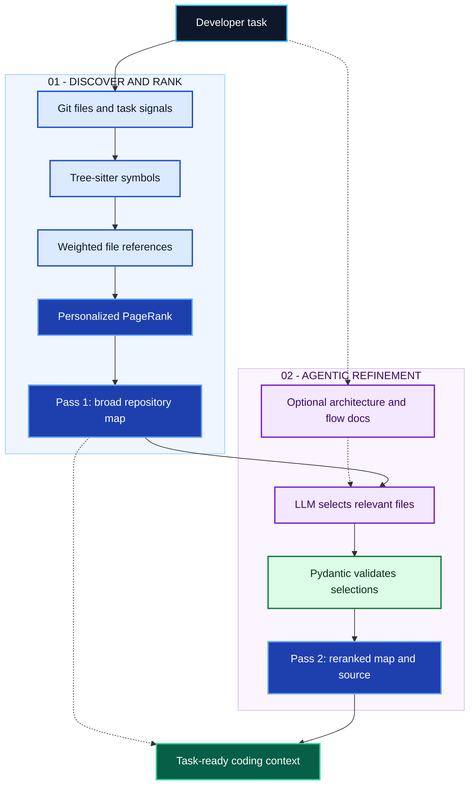

# Agentic Coding Context Builder

**Give coding agents the code that matters—not the entire repository.**

A task-aware context engine that combines **tree-sitter**, **personalized PageRank**, **Git history**, and **LLM-guided file selection** to prepare focused repository context before an AI coding assistant starts working.

**Explore the codebase intelligently. Rank what matters. Deliver actionable context.**

[Quick start](#quick-start) · [How it works](#how-it-works) · [API](#api-and-interfaces) · [Algorithm internals](docs/ALGORITHM.md)

---

## Why this exists

A coding agent needs relevant interfaces, implementation paths, and tests—not thousands of unrelated lines. This project builds a ranked, task-specific repository map, then lets an LLM refine that ranking and attach the most useful source files.

| What goes in | What comes out |
| --- | --- |
| Repository path + natural-language task | Ranked code map + navigational notes + selected source excerpts |
| Optional architecture and feature-flow documents | Better task-to-file grounding |
| Git history and symbol references | Context beyond filename keyword matches |

**Two modes:** deterministic mapping (no LLM required), or agentic mapping (two-pass file selection through OpenRouter).

## Quick start

**Requirements:** Python 3.11+, Git, and an [OpenRouter](https://openrouter.ai/) key for agentic mode.

```bash
git clone https://github.com/MohammadAsadolahi/Agentic-Coding-Context-Builder.git
cd Agentic-Coding-Context-Builder

python3 -m venv .venv
source .venv/bin/activate
pip install -r requirements.txt
cp .env.example .env
```

Set `OPENROUTER_API_KEY` in `.env`. The example file also supplies `OPENROUTER_MODEL` and `REPO_MAP_MODEL`.

```bash
# Two-pass, LLM-guided context
python app.py --root /absolute/path/to/repo --prompt "fix authentication middleware"

# Single-pass, no LLM call
python repo_map_generator.py --prompt "fix authentication middleware" /absolute/path/to/repo
```

## How it works



*Solid arrows show the agentic path; the dashed line from Pass 1 to the result is the single-pass alternative. Architecture documents are optional.*

1. **Discover.** Find tracked files; match prompt terms, identifiers, and filenames; enrich task relevance using Git recency and co-change history.
2. **Rank.** Extract symbol definitions and references, build a directed file graph, and use personalized PageRank to prioritize relevant code.
3. **Refine.** An LLM reviews the broad map and optional architecture documents, selects files to boost or downgrade, and returns navigational notes.
4. **Deliver.** Pydantic validates selections. A second ranking pass builds the focused map and appends selected source excerpts.

### The ranking idea

A file referencing a symbol defined elsewhere creates a directed edge **referencing file → defining file**. Edge weights reflect symbol usage and relevance. PageRank propagates importance across those references, while a *personalization vector* biases the ranking toward task-related files.

```text
User task → relevant file seeds → weighted reference graph
                                 ↓
                         Personalized PageRank
                                 ↓
                       Ranked definitions + map
```

The second pass **seeds the agent-selected files before boosting** their personalization, so an important file can be promoted even if it wasn't named in the prompt. The agent changes ranking preferences; it does not rewrite source dependencies.

**[Read the full algorithm](docs/ALGORITHM.md)** for edge-weight factors, the PageRank equation, 30-day Git-recency decay, token-budget behavior, graph limitations, and LLM exploration rules.

## API and interfaces

**HTTP service:**

```bash
uvicorn service:app --host 127.0.0.1 --port 8000

curl -X POST http://127.0.0.1:8000/map \
  -H 'Content-Type: application/json' \
  -d '{"root":"/absolute/path/to/repo","prompt":"fix authentication","agentic":true}'
```

`POST /map` returns the repository map, ranked/selected filenames, model metadata, and optional agentic steps. `GET /health` returns service health. The API defaults to **single-pass mode** (`"agentic": false`).

**Visual explorer:** From `plotter/`, run `npm ci && npm run dev` (with the API running) to open the React Flow view at `http://localhost:5199`. It shows file relationships, heat-based ranking indicators, request controls, and run diagnostics. The viewer's heat is an approximation based on map order and symbol density—not raw PageRank.

**Docker:** `docker compose up --build` exposes the API on port 8000. The included compose file mounts host files read-only under `/host`; use container-visible paths when making requests.

## Configuration

| Variable | Purpose |
| --- | --- |
| `OPENROUTER_API_KEY` | Required for agentic mode |
| `OPENROUTER_MODEL` | LLM for file selection and default feature triage |
| `REPO_MAP_MODEL` | Model configuration used by Aider for map/token sizing |
| `OPENROUTER_BASE_URL` | Optional OpenRouter-compatible endpoint |
| `TRIAGE_MODEL` | Optional separate model for feature triage |

Optional project context: `.architectureX/project_dictionary.json` maps feature names to files. `.architectureX/01_GENERAL_ARCHITECTURE.md` and `.architectureX/flows/` can supply the agent with architecture and feature-flow guidance.

## Development

```bash
pip install -r requirements-dev.txt
python -m pytest -q tests/test_schemas.py

# LLM-backed stress tests on a representative repository
python audit_runner.py /path/to/repo
python audit_runner_40.py /path/to/repo
```

Core modules: `repo_map_generator.py` (structural ranking), `agentic_mapper.py` (LLM-guided refinement), `schemas.py` (Pydantic contracts), `service.py` (FastAPI), and `plotter/` (React visualization).

**Security:** The API accepts server-side filesystem paths and can return source contents. Restrict access and mounts; do not expose it on an untrusted network without authentication. Agentic mode sends repository context to the configured model provider.

---

Built on [Aider](https://github.com/Aider-AI/aider), [NetworkX](https://networkx.org/), and [Pydantic](https://docs.pydantic.dev/latest/). Licensed under [MIT](LICENSE).
