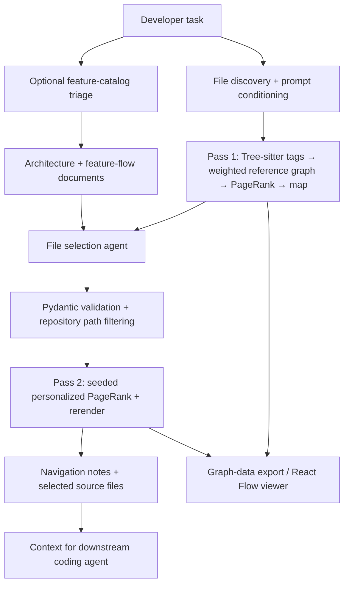

# Agentic Coding Context Builder

**Task-aware repository analysis and context assembly for AI coding agents.**

Agentic Coding Context Builder constructs a focused, inspectable context payload for a developer's task. It combines [Aider's](https://aider.chat/docs/repomap.html) tree-sitter symbol extraction and weighted PageRank with prompt relevance, Git history, optional architecture documents, and an LLM-guided second pass. Instead of supplying an entire repository to a coding assistant, it selects and explains the pieces most likely to matter.

**Scope:** This is a context builder, not an autonomous code editor. It does not modify the source of the target repository. Agentic mode uses OpenRouter for file-selection reasoning; deterministic mode does not require an LLM call.

## How it works



Pass 1 creates a broad structural map. If `.architectureX/01_GENERAL_ARCHITECTURE.md` contains a **Feature Catalog**, a lightweight LLM triages up to two relevant features concurrently with map generation. The main agent then receives the map and available architecture/flow documents. It selects which files to boost or downgrade and provides short navigational guidance. Pass 2 reranks the map and appends selected source code.

The system's core distinction is **structural evidence versus task relevance**: tree-sitter and PageRank estimate the dependency structure, while prompt matching and LLM selection specify where to explore that structure.

## Algorithm in detail

### 1. File discovery and prompt conditioning

`repo_map_generator.py` first asks Aider's `GitRepo` for tracked files. It supports immediate nested Git repositories under a common root (with prefixed paths) and falls back to a filtered filesystem walk when Git discovery is unavailable. The fallback excludes common build directories, dependencies, and binary extensions.

The task text is examined for file paths, unique basenames, identifiers, and filename-stem matches. These yield `mentioned_fnames` and `mentioned_idents`. A project dictionary can add feature-to-file matches:

```json
{
  "user-authentication": ["src/auth.py", "src/middleware.py"],
  "payment-processing": ["src/billing.py", "src/stripe_client.py"]
}
```

Place it at `.architectureX/project_dictionary.json`. Prompt word n-grams of one to three words are matched to hyphenated keys. Dictionary matches become task seeds and receive a 3× personalization modifier later.

### 2. Git history as an exploration signal

**Recency:** For each file observed in up to 50 recent commits, use the last observed modification time to compute

$$
r(f) = 2^{-\Delta t_f / 30}
$$

where `Δt_f` is elapsed time in days. The implemented decay has a **true 30-day half-life**. The top 20 recent files are identified, but only files already mentioned by the task receive recency boosts; this guards against unrelated recent edits.

**Co-change:** Look through up to 200 commits and count files committed together with seeded files. A file becomes eligible if it co-changed at least twice; up to 10 such files are promoted. This can reveal tests, migrations, configuration, and other coupling invisible to source-symbol references.

These heuristics **expand the task-relevant file seeds**. They are not themselves additional dependency edges or directly summed into PageRank scores.

### 3. Build the weighted file-reference graph

Aider extracts `def` (definition) and `ref` (reference) tags with tree-sitter and may fall back to Pygments for references where supported parsers only expose definitions. It creates a NetworkX `MultiDiGraph`: **files are vertices**, and an identifier referenced by file `u` and defined by file `v` creates a directed edge `u → v`.

The direction is important: *referencing/dependent file → defining/provider file*. Parallel edges can represent different identifiers between the same files. A small self-loop with weight 0.1 can preserve a definition with no detected references.

For identifier `s`, Aider computes an edge weight approximately as

$$
w(u,v;s)=\sqrt{c(u,s)}\cdot
m_{\mathrm{mentioned}}\cdot
m_{\mathrm{distinctive}}\cdot
m_{\mathrm{private}}\cdot
m_{\mathrm{overloaded}}\cdot
m_{\mathrm{chat}}
$$

where `c(u,s)` is the number of occurrences of `s` referenced by `u`, and the multipliers are:

| Condition | Weight |
| --- | ---: |
| Identifier explicitly mentioned in task | 10× |
| Distinctive camelCase/snake_case/kebab-case identifier at least 8 characters long | 10× |
| Identifier begins with underscore | 0.1× |
| Identifier defined in more than five files | 0.1× |
| Referencing file is explicitly in the chat | 50× |

The factors multiply; `sqrt(count)` dampens repetitive names. The **chat 50× factor applies to outgoing graph edges**, not automatically to every agent-selected file.

**Example:** If `handlers/login.py` references `authenticate` defined in `auth/service.py`, the graph includes `handlers/login.py → auth/service.py`. If that service references `issue_token` defined in `auth/tokens.py`, the graph includes `auth/service.py → auth/tokens.py`. The structural ranking can therefore surface important implementation paths even when those file names are not in the task.

**Limit:** This is a symbol-reference graph, not a proven runtime call graph. Dynamic dispatch, name collisions, reflection, generated code, and parser coverage can limit its fidelity.

### 4. Personalized PageRank

NetworkX PageRank scores files from weighted links and a task-biased teleportation distribution. In simplified form, with damping factor `α = 0.85`:

$$
PR_{t+1}(v) = (1-\alpha)p(v) +
\alpha\sum_{u\rightarrow v}PR_t(u)\frac{w(u,v)}{\sum_x w(u,x)}
$$

Here `PR(v)` is the importance of file `v`; `p(v)` is its *normalized personalization weight*; and `w(u,v)` aggregates weights of edges from `u` to `v`. Dangling nodes follow the personalization distribution when supplied.

Aider seeds personalization for files already in chat, explicitly mentioned filenames, and path components matched against mentioned identifiers. The builder changes **the personalization vector before ranking**, not the final PageRank scores:

| Signal | Default multiplier | Effect |
| --- | ---: | --- |
| Project dictionary match | 3× | Promotes matched domain files |
| Agent-selected file | 10× | Seeds a selected file, then raises its personalization |
| Agent-downgraded file | 0.1× via API; 0.05× generator fallback | Reduces *existing* personalization |

**Why seeding matters:** If a selected file has no entry in Aider's personalization vector, multiplying zero changes nothing. In Pass 2, the builder now explicitly adds agent-selected files to `mentioned_fnames` *before* applying their configurable boost factor. This makes the selected-file boost effective even when the original task did not mention the filename.

Downgrading affects only files with existing personalization; it does **not** remove a vertex, delete edges, multiply its final rank by 0.1, or guarantee exclusion. The actual rank shift depends on graph topology and normalization.

An optional NVIDIA RAPIDS cuGraph implementation is attempted for PageRank when available, with NetworkX as CPU fallback. Floating-point rankings can differ slightly between implementations.

### 5. Translate PageRank into a token-bounded map

After PageRank, Aider distributes each source file's rank across its outgoing edges proportionally to edge weight, crediting **(defining file, identifier)** pairs:

$$
\mathrm{credit}(v,s)\;{+}{=}\;PR(u)\,\frac{w(u,v;s)}{\sum_x w(u,x)}
$$

These definition tags are sorted by credit and rendered with source structure and contextual lines. Important definitions appear earlier; lesser-priority details are compressed or omitted. Files with no usable tags can still appear. Aider searches for how many ranked tags fit the available token budget.

**Actual budgets in this implementation:** `RepoMap` is configured with `map_mul_no_files=2`. When there are no chat files, the map target is up to **2×** the model's map-token setting, capped by its input limit minus 4,096 reserved tokens. Both passes currently use the same 2× no-chat setting; there is **no implemented 8× first-pass budget**. The structural map's budget is separate from the additional source-injection allowance.

When map generation is empty, fallback attempts run without chat files and then without task hints.

## Agentic graph exploration and Pass 2

The agent **does not modify the graph's reference edges**. It reads the structural map and advises which files should receive more or less teleportation weight.

1. **Architecture triage (optional):** If a Feature Catalog exists in `.architectureX/01_GENERAL_ARCHITECTURE.md`, a small LLM classifies the task into zero to two feature IDs. The corresponding `.architectureX/flows/*.md` files are supplied to the main agent. This runs alongside Pass 1.
2. **Exploration:** The main LLM receives the task, architecture, flow docs, and repo map. When one feature remains unclear, it can call `get_feature_details` once to retrieve its flow and optional `.architectureX/flows/flow_files_dictionary.json` file list.
3. **Selection:** The prompt guides the agent toward roughly **3–12 files to boost**, **0–15 to downgrade**, and short notes about hidden coupling and call/data-flow direction. Broad cross-cutting tasks should have no downgrades; these ranges are guidance rather than hard enforcement.
4. **Validation:** `FileSelectionResult` (Pydantic v2) parses the LLM JSON, normalizes repository-relative paths, rejects absolute/traversal paths, and deduplicates. The pipeline then removes filenames absent from file discovery and makes boosts take precedence over downgrades.
5. **Reranking:** Pass 2 reseeds selected files, applies configured personalization factors, and rerenders the map. The result cache keys on the repository fingerprint, prompt, model, selections, and factor values; the Aider map cache is bypassed when customized ranking requires recomputation.
6. **Context assembly:** Navigational notes are prepended; selected readable files are appended in priority order, capped at **500 lines per file** and about **30,000 extra tokens** (estimated using four characters/token). Symlinks resolving outside the repository are skipped.

If the first LLM response is valid JSON, it is used directly. Otherwise, a structured-output LLM call is attempted, followed by a raw-JSON fallback. An LLM failure returns the broad map. Missing required agentic configuration produces an explicit error (HTTP **503** in service mode).

## Pydantic contracts and API

The shared `schemas.py` module defines:

| Schema | Role |
| --- | --- |
| `MapRequest` | Absolute root, nonblank task, finite bounded ranking factors; rejects unexpected request fields |
| `FileSelectionResult` | Validates LLM selection payload and safe relative file paths |
| `RepoMapResult` | Shared result and typed diagnostic steps for deterministic/agentic passes |
| `MapResponse` | Validated HTTP response with logs |

FastAPI responds **422** to invalid payloads, **400** for nonexistent roots, and **503** for missing agentic configuration.

### POST /map

```bash
curl -X POST http://127.0.0.1:8000/map \
  -H 'Content-Type: application/json' \
  -d '{
    "root": "/absolute/path/to/repo",
    "prompt": "fix authentication middleware",
    "agentic": true,
    "boost_factor": 10.0,
    "downgrade_factor": 0.1
  }'
```

`agentic` defaults to `false`. The `boost_factor` must be greater than 0 and at most 100; `downgrade_factor` must be greater than 0 and at most 1. Response fields include `repo_map`, `rel_files`, `mentioned_fnames`, `agent_boost_fnames`, `agent_downgrade_fnames`, `agentic_steps`, `agentic_log`, Git/dictionary boosts, and model/token-budget metadata.

### GET /health

Returns `{"status": "ok"}`.

## Installation

**Prerequisites:** Python 3.11+, Git, and an [OpenRouter](https://openrouter.ai/) key for agentic mode. Node.js/npm is needed for the development viewer.

```bash
git clone https://github.com/MohammadAsadolahi/Agentic-Coding-Context-Builder.git
cd Agentic-Coding-Context-Builder
python3 -m venv .venv
source .venv/bin/activate
pip install -r requirements.txt
cp .env.example .env
```

Configure `.env` using these variables:

| Variable | Purpose |
| --- | --- |
| `OPENROUTER_API_KEY` | Required in agentic mode |
| `OPENROUTER_MODEL` | Agent selection model; also triage by default |
| `OPENROUTER_BASE_URL` | Defaults to `https://openrouter.ai/api/v1` |
| `REPO_MAP_MODEL` | Aider tokenizer/map configuration; not an API call |
| `TRIAGE_MODEL` | Optional model override for feature triage |

### Run from CLI

```bash
# Two-pass agentic mode
python app.py --root /absolute/path/to/repo --prompt "fix authentication"

# Deterministic single-pass mode
python repo_map_generator.py --prompt "fix authentication" /absolute/path/to/repo
```

### Start API and frontend

```bash
uvicorn service:app --host 127.0.0.1 --port 8000
# In another terminal:
cd plotter && npm ci && npm run dev
# Visit http://localhost:5199
```

Or launch both development services from the project root using `./cli.sh run` after installing frontend packages.

The React Flow visualization shows exported file nodes and a **simplified** dependency graph. **Its heat color is not raw PageRank:** it combines map-order position (70%) and symbol count (30%). The visualization reconstructs links from the rendered map's selected files, and it only draws links with at least three distinct symbol references. The underlying ranking graph may be larger and structurally different.

### Docker and remote deployment

```bash
docker compose up --build
```

The compose setup mounts the host filesystem read-only at `/host`. Pass container-visible paths such as `/host/home/user/project` to the API. `docker-compose.offline.yml` supports internal package mirrors; `deploy.sh` supports SSH-based deployment.

## Testing and diagnostics

```bash
pip install -r requirements-dev.txt
python -m pytest -q tests/test_schemas.py
python -m compileall -q schemas.py service.py agentic_mapper.py repo_map_generator.py

# LLM-backed stress harnesses (require configured model and sample repo)
python audit_runner.py /path/to/target-repo
python audit_runner_40.py /path/to/target-repo
```

The Pydantic contract tests require no model credentials. The 20- and 40-prompt audits exercise broad prompt categories but do not compare selected files against a labeled ground-truth dataset.

Result caching uses a Git fingerprint (HEAD, tracked working-tree state, dirty-file mtimes), prompt, model, dictionary metadata, selected paths, and ranking factors; tag caches are reused across passes. A fixed `PYTHONHASHSEED=0` improves repeatability, but it does not guarantee identical GPU floating-point results or eliminate external model variability.

## Security and operational considerations

- `POST /map` reads server-visible repository files and can return source text. **Do not expose it to untrusted networks** without authentication, filesystem restrictions, and appropriate authorization.
- Agentic mode transmits task, repo-map, and optional architecture context to the configured LLM provider. Review privacy and provider policies before using confidential repositories.
- Map generation is serialized within a Python process because personalization and the cached Aider `RepoMap` are shared state.
- A reference graph is evidence of likely code relationships, not proof of runtime execution. Inspect the actual code and test edits before relying on its suggestions.

## Project layout

| File / directory | Responsibility |
| --- | --- |
| `repo_map_generator.py` | Git discovery, prompt conditioning, Aider graph/PageRank, caching, visualization export |
| `agentic_mapper.py` | Feature triage, file selection, second pass, context/source injection |
| `schemas.py` | Shared Pydantic v2 validation |
| `service.py` / `app.py` | FastAPI / agentic CLI |
| `plotter/` | React, TypeScript, Vite, React Flow |
| `run_local.py` / `cli.sh` | Combined runner / local dev commands |
| `tests/` | Contract regression tests |
| `audit_runner*.py` | LLM prompt stress harnesses |
| `Dockerfile` / `docker-compose*.yml` / `deploy.sh` | Deployment |

## Foundations and license

Built on [Aider](https://github.com/Aider-AI/aider), [NetworkX](https://networkx.org/), [tree-sitter](https://tree-sitter.github.io/tree-sitter/), [LangChain](https://python.langchain.com/), [Pydantic](https://docs.pydantic.dev/latest/), and [FastAPI](https://fastapi.tiangolo.com/). Aider supplies the base graph/ranking and symbol-rendering engine; this project adds task-aware orchestration, Git-context enrichment, typed validation, and visualization.

Licensed under [MIT](LICENSE).
